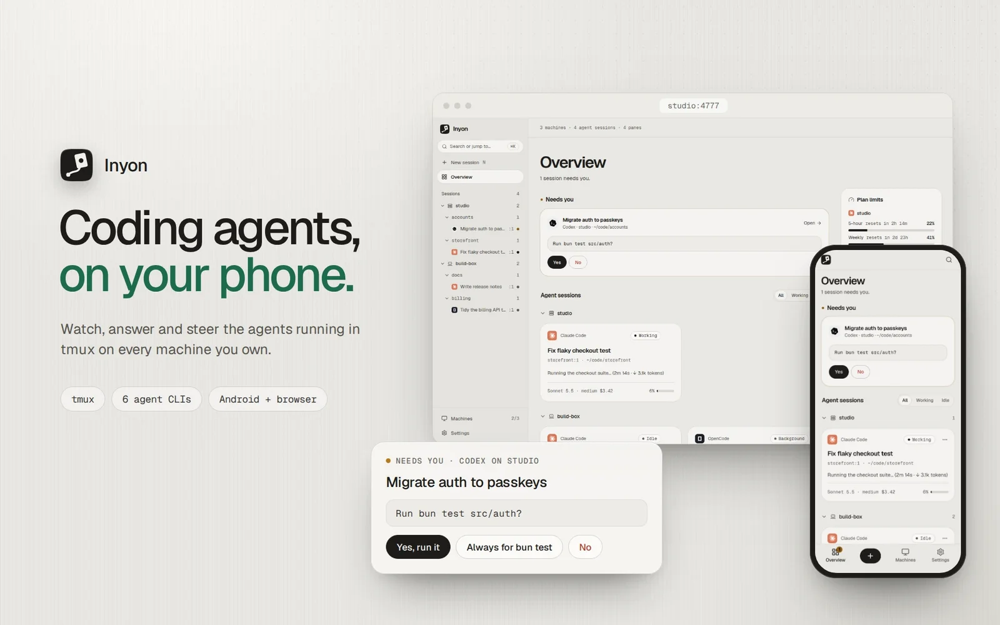
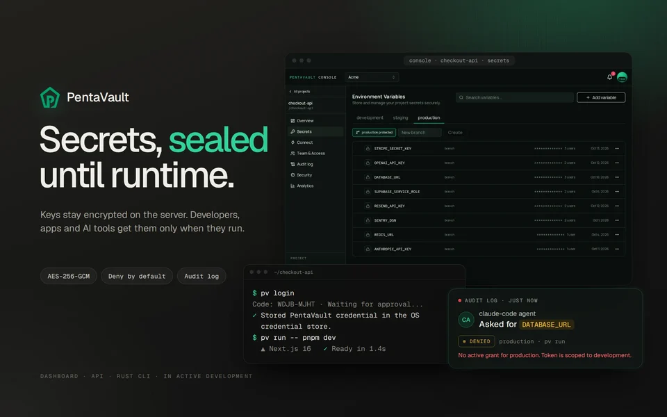
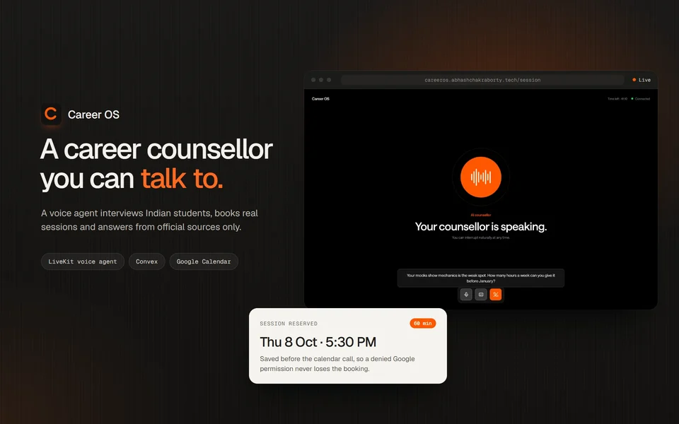
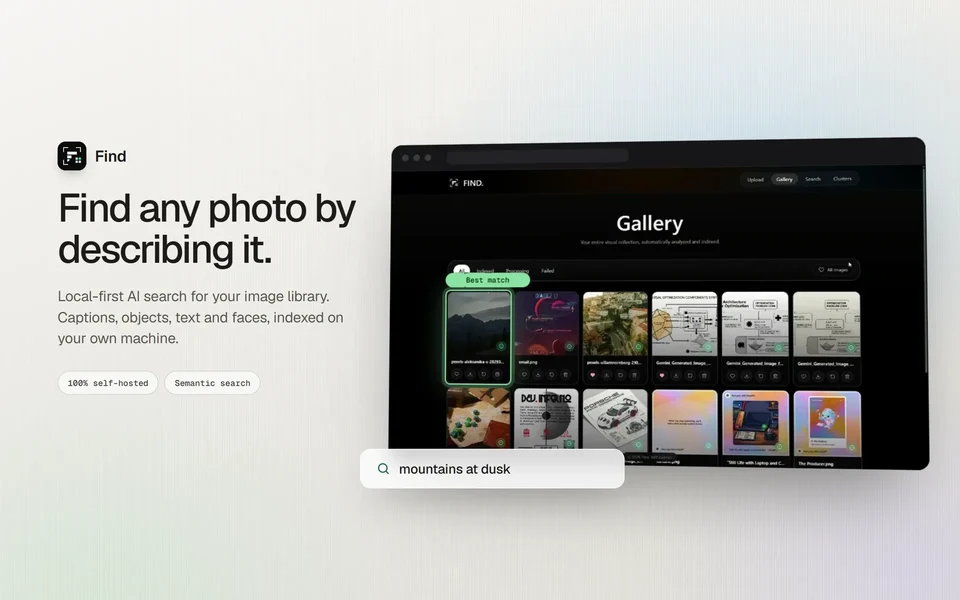
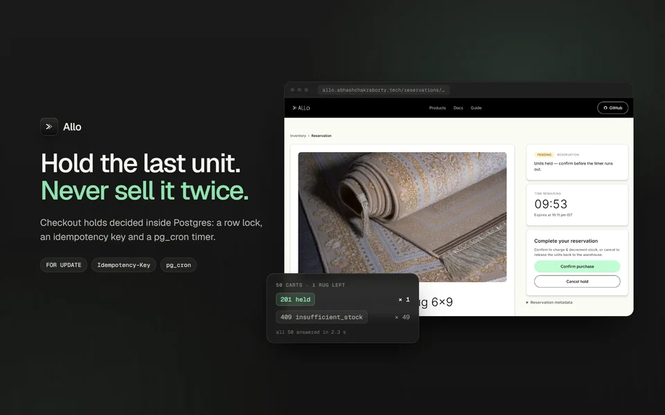
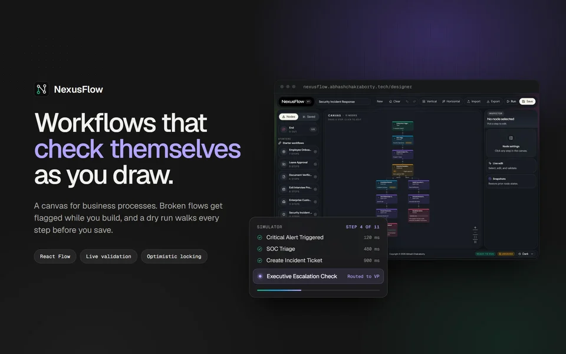
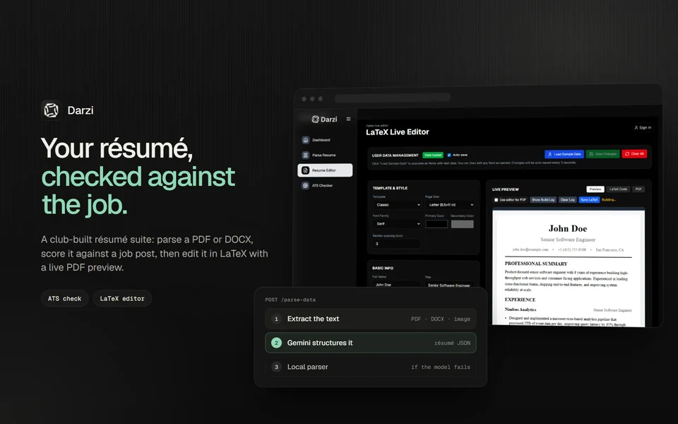

<picture>
  <source media="(prefers-color-scheme: dark)" srcset="https://assets.abhashchakraborty.tech/brand/github-banner-dark.png" />
  
</picture>

<p align="center">
  <a href="https://abhashchakraborty.tech"></a>
  <a href="https://abhashchakraborty.tech/writing"></a>
  <a href="https://www.linkedin.com/in/abhash-chakraborty-b78862247/"></a>
  <a href="https://x.com/Abhashchakrab14"></a>
  <a href="https://www.youtube.com/@abhash.chakraborty"></a>
  <a href="mailto:work@abhashchakraborty.tech"></a>
</p>

```console
$ whoami
Abhash. Software developer at SAITS, a Swiss AI services company, and a final-year
AI & ML student at VIT Bhopal (Integrated M.Tech).

$ cat now.txt
Fine-tuning small open LLMs. Launching Inyon.

$ cat what-i-do.txt
I put models inside things people actually use, then keep working on them until
they're boring enough to trust.
```

## Latest: Inyon

<a href="https://inyon.abhashchakraborty.tech"></a>

My coding agents kept stopping to ask "can I run the tests?" while I was away from my desk, so I built them a remote. **[Inyon](https://inyon.abhashchakraborty.tech)** puts every agent running in my tmux on my phone, and one tap types the answer back into the same pane. It works with Claude Code, Codex, Gemini CLI, OpenCode, Copilot CLI and Antigravity CLI, needs no account and no server to host, and it's free.

<p>
  <a href="https://www.npmjs.com/package/@abhash-chakraborty/inyon"></a>
  <a href="https://github.com/Abhash-Chakraborty/inyon/releases/latest"></a>
  <a href="https://github.com/Abhash-Chakraborty/inyon/blob/main/LICENSE"></a>
</p>

[Website](https://inyon.abhashchakraborty.tech) · [Repo](https://github.com/Abhash-Chakraborty/inyon) · [How I built it](https://abhashchakraborty.tech/writing/inyon) · [90-second demo](https://www.youtube.com/watch?v=NKEb2Pn6ZvQ)

## Other things I've built

<table>
  <tr>
    <td width="50%" valign="top">
      <a href="https://abhashchakraborty.tech/projects/pentavault"></a>
      <br /><b><a href="https://abhashchakraborty.tech/projects/pentavault">PentaVault</a></b> · in development<br />
      Secrets stay sealed until a command actually runs. When an AI agent asks for the production key, it gets a no, and the no goes in the audit log.<br />
      <a href="https://github.com/PentaVault/PentaVault">Repo</a>
    </td>
    <td width="50%" valign="top">
      <a href="https://abhashchakraborty.tech/projects/careeros"></a>
      <br /><b><a href="https://abhashchakraborty.tech/projects/careeros">Career OS</a></b> · live<br />
      A career counsellor you can call. It interviews you by voice, books a real session on your Google Calendar and answers only from official sources.<br />
      <a href="https://careeros.abhashchakraborty.tech">Live</a> · <a href="https://github.com/Abhash-Chakraborty/CareerOS">Repo</a>
    </td>
  </tr>
  <tr>
    <td width="50%" valign="top">
      <a href="https://abhashchakraborty.tech/projects/find"></a>
      <br /><b><a href="https://abhashchakraborty.tech/projects/find">Find</a></b> · shipped<br />
      Describe a photo in plain words and get the photo back. Every model runs on your own machine, so your pictures never leave it.<br />
      <a href="https://github.com/Abhash-Chakraborty/Find">Repo</a>
    </td>
    <td width="50%" valign="top">
      <a href="https://abhashchakraborty.tech/projects/allo"></a>
      <br /><b><a href="https://abhashchakraborty.tech/projects/allo">Allo</a></b> · live<br />
      Fifty carts race for the last rug. One gets it and forty-nine get a 409, thanks to a Postgres row lock and a hold timer.<br />
      <a href="https://allo.abhashchakraborty.tech">Live</a> · <a href="https://github.com/Abhash-Chakraborty/Allo-Project">Repo</a>
    </td>
  </tr>
  <tr>
    <td width="50%" valign="top">
      <a href="https://abhashchakraborty.tech/projects/nexusflow"></a>
      <br /><b><a href="https://abhashchakraborty.tech/projects/nexusflow">NexusFlow</a></b> · shipped<br />
      A workflow designer that tells you the flow is broken while you're still drawing it, then walks through it one step at a time.<br />
      <a href="https://nexusflow.abhashchakraborty.tech/designer">Live</a> · <a href="https://github.com/Abhash-Chakraborty/NexusFlow">Repo</a>
    </td>
    <td width="50%" valign="top">
      <a href="https://abhashchakraborty.tech/projects/darzi-ai"></a>
      <br /><b><a href="https://abhashchakraborty.tech/projects/darzi-ai">Darzi AI</a></b> · live<br />
      A résumé suite our university AI club built: parse a résumé, check it against a job post and edit it in LaTeX. I built most of the backend API.<br />
      <a href="https://darze.vercel.app">Live</a> · <a href="https://github.com/VIT-Bhopal-AI-Innovators-Hub/Darzi-AI-Resume-Suite">Repo</a>
    </td>
  </tr>
</table>

Smaller builds and forks live on [my projects page](https://abhashchakraborty.tech/projects).

## Open source

- **[Dokploy](https://github.com/Abhash-Chakraborty/dokploy)**: I maintain my own build of this self-hosted PaaS and run my servers on it. 184 commits and 21 releases add fleet SSH, a firewall that rolls itself back if it locks me out, an encrypted vault and restic backups with restore drills.
- **[mem0](https://github.com/Abhash-Chakraborty/mem0)**: a self-hosted memory server with an entity graph, webhooks and a one-container pgvector image, synced with upstream every week.
- **[recodehive](https://github.com/recodehive/recode-website/pulls?q=is%3Apr+author%3AAbhash-Chakraborty+is%3Amerged)**: 7 merged PRs, including Clerk sign-in, Algolia search and a fix that stopped exposing tokens in the browser.
- **[Gityzer](https://github.com/vansh-codes/Gityzer/pulls?q=is%3Apr+author%3AAbhash-Chakraborty+is%3Amerged)**: 9 merged PRs during Social Winter of Code 2025, among them the AI badge generator and SVG rendering. Second-largest contributor.
- **[Nyay Sathi](https://github.com/vikas872/nyay-sathi-clean/pull/1)**: my v2.0 upgrade moved this Indian-law assistant to agentic RAG with cited sources.

## What I build with

<p>
  
  
  
  
  
  
  
  
  
  
  
  
  
  
  
  
</p>

<div align="center">
  <picture>
    <source media="(prefers-color-scheme: dark)" srcset="https://github-readme-stats.vercel.app/api?username=Abhash-Chakraborty&show_icons=true&count_private=true&hide_border=true&theme=github_dark&bg_color=0d1117" />
    
  </picture>
  <picture>
    <source media="(prefers-color-scheme: dark)" srcset="https://github-readme-stats.vercel.app/api/top-langs?username=Abhash-Chakraborty&layout=compact&langs_count=5&card_width=320&hide_border=true&theme=github_dark&bg_color=0d1117" />
    
  </picture>
  <picture>
    <source media="(prefers-color-scheme: dark)" srcset="https://raw.githubusercontent.com/Abhash-Chakraborty/Abhash-Chakraborty/output/github-snake-dark.svg" />
    <source media="(prefers-color-scheme: light)" srcset="https://raw.githubusercontent.com/Abhash-Chakraborty/Abhash-Chakraborty/output/github-snake.svg" />
    
  </picture>
</div>

<p align="center">Made it this far? My site has <a href="https://abhashchakraborty.tech/terminal">a terminal</a> with Snake, 2048 and a daily challenge, and the leaderboard is open.</p>
